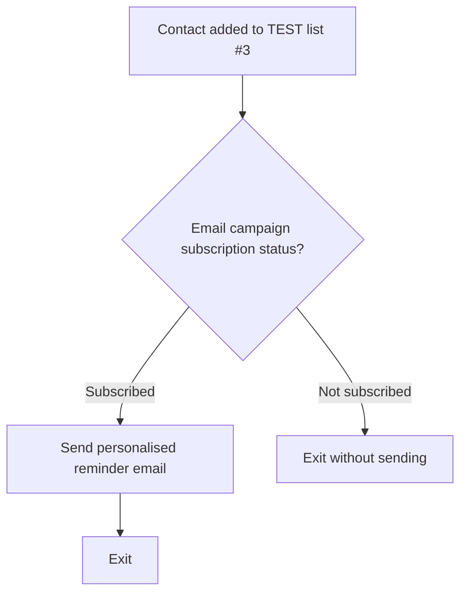

# AutoConnect — Phase 04: Brevo Journey Implementation

**Project:** AutoConnect — AI-Powered CRM Lifecycle Automation  
**Version:** 1.0  
**Date:** 2026-11-04  
**Scope:** T10–T13 (Brevo journey setup and controlled email testing)  
**Project type:** Independent educational prototype for a fictional European vehicle marketplace  
**Status:** Phase 04 implementation and editor test complete; live automation execution not tested

## 1. Objective and scope

Demonstrate a saved-search re-engagement email journey using Brevo's contact attributes, a test-only contact list, a subscription-based branch and a personalised email. All marketplace customers and vehicle preferences in the underlying SQL dataset are synthetic. The Brevo recipient used for delivery testing was an email address owned and controlled by the project author.

This phase does **not** establish a live marketplace integration, automated import of SQL-qualified audiences into Brevo, production consent processing or live journey execution.

## 2. T10 — Brevo configuration

- Created a Brevo Free account for the AutoConnect educational project.
- Used the standard `EMAIL` identifier and `FIRSTNAME` contact attribute.
- Created custom text attributes: `CUSTOMER_ID`, `VEHICLE_MAKE`, `VEHICLE_MODEL`.
- Created CRM contact list **AutoConnect - Saved Search Re-engagement - TEST**, list ID **3**.
- Initially encountered pending account validation; subsequently confirmed that the email sending status was **Validated**.

**Evidence:** `docs/evidence/phase-04/t10-attributes.png`, `t10-test-list.png` (if available).

## 3. T11 — Controlled test contact

- Created a single fictional persona, **Lena**, with a self-owned Outlook test address.
- Configured `CUSTOMER_ID=TEST001`, `FIRSTNAME=Lena`, `VEHICLE_MAKE=Volkswagen`, `VEHICLE_MODEL=Golf`.
- Marked the test contact as subscribed and added it to CRM list ID 3.
- Contact was created **manually**, not via a CSV import. This satisfies the test-contact setup objective but does not demonstrate a bulk contact-import pipeline.
- No addresses from the synthetic `example.com` SQL export were imported as sendable Brevo contacts.

**Evidence:** `docs/evidence/phase-04/t11-test-contact.png` (if available; redact email addresses).

## 4. T12 — Journey implementation

**Workflow:** `AutoConnect | Saved Search Re-engagement | TEST`  
**Status when documented:** Saved and **Inactive**.

**Trigger:** Contact added to list ID 3.  
**Conditional split:** Email campaigns subscriptions = Subscribed.  
**Positive branch:** Send a single personalised email, then exit.  
**Negative branch:** Exit without sending.  
**Activation:** Not activated during this phase.

**Email configuration:**

- Subject: `Still interested in your saved vehicle search?`
- Preview text: `Your saved vehicle preferences are waiting`
- Heading: `Your saved vehicle search is waiting`
- Personalisation attributes: `FIRSTNAME`, `VEHICLE_MAKE`, `VEHICLE_MODEL`.
- The email explicitly identifies AutoConnect as a fictional marketplace used for an educational CRM automation project.
- No working saved-search landing page or call-to-action URL was implemented.

**Evidence:** `docs/evidence/phase-04/t12-workflow.png`, `t12-personalisation-preview.png`.

## 5. T13 — Controlled email test and findings

**Pre-send checks:**

- Brevo sending status was reported as **Validated**.
- The test workflow remained inactive.
- The selected test recipient address was owned and controlled by the project author.
- The fictional Lena CRM contact had `Subscribed` status.
- The test used Brevo's **Preview & test → Send test email** function, not an activated workflow run.

| Test | Observed result | Interpretation |
| --- | --- | --- |
| Recipient preview using Lena contact | `Hi Lena` and `Volkswagen Golf` rendered | PASS — contact attributes resolve in preview |
| Test send to author's Gmail address | Message delivered, but personalisation fields were blank | PARTIAL — delivery passed; personalised rendering did not |
| Test send to Lena's self-owned Outlook address | Message delivered; `Hi Lena` and `Volkswagen Golf` rendered | PASS — delivered email personalisation verified |
| Sender, subject and preview text | Configured and visible in previews | PASS |
| Unsubscribe affordance | Visible in Gmail test email | OBSERVED — unsubscribe processing itself not tested |
| Live workflow trigger and branch execution | Not executed | NOT TESTED |
| SQL-to-Brevo audience transfer | Not implemented | NOT TESTED |

**Root-cause caution:** The first test was sent to a different address than the Lena contact. This is a plausible explanation for the blank values, but the exact cause was not independently established. The successful Outlook retest demonstrates that personalisation can render correctly for the configured contact.

**Evidence:** `docs/evidence/phase-04/t13-delivered-personalised-email.png`, optionally `t13-initial-test-limitation.png`. Redact all personal addresses, account identifiers and unrelated inbox information.

## 6. Control boundaries and limitations

### Implemented in the SQLite/SQL prototype (T01–T09)

- Seven-day inactivity eligibility and saved-search fallback.
- Current and latest-history consent checks.
- Fourteen-day same-campaign suppression.
- Deterministic saved-search selection and audience deduplication.
- Synthetic dataset, audience export and 13 passing SQL validation queries.

### Implemented in Brevo (T10–T13)

- Dedicated test list and one owned-address test contact.
- Subscription-status conditional branch.
- Personalised email template.
- Successful test email delivery and rendered personalisation.

### Not implemented or not demonstrated

- Automated SQL-to-Brevo synchronisation or audience eligibility enforcement in Brevo.
- Seven-day inactivity and 14-day suppression checks inside the Brevo workflow.
- Automated campaign frequency enforcement across repeated sends.
- Live workflow activation, trigger execution or branch logs.
- Production customer consent provenance, verified unsubscribe processing, bounce handling or monitoring.
- Real marketplace landing page, return-visit tracking or seller-enquiry tracking.
- AI agent and human approval gate (planned for Phase 05).

**Safety decision:** The workflow remains **Inactive**. Do not import or email synthetic `example.com` addresses. Do not activate the automation before validating end-to-end eligibility, consent and frequency controls with an approved test plan.

## 7. Reproduction outline

1. Create a Brevo account and verify sending eligibility.
2. Configure `FIRSTNAME`, `CUSTOMER_ID`, `VEHICLE_MAKE` and `VEHICLE_MODEL` contact attributes.
3. Create a dedicated test-only CRM list.
4. Add a fictional test contact with an address you own and explicit test subscription status.
5. Create an automation from scratch with a **Contact added to list** trigger.
6. Add a conditional split checking **Email campaigns subscriptions = Subscribed**.
7. Route the subscribed branch to one personalised email action, then Exit; route the other branch directly to Exit.
8. Preview as the test contact and confirm attribute resolution.
9. With the automation inactive, use the editor's test-email function to send to the owned test address.
10. Confirm receipt and rendered values; preserve redacted evidence.

These steps reproduce the **editor test** and configuration, not an end-to-end production lifecycle journey.

## 8. Phase 04 completion criteria

- [x] T10: Brevo account, attributes and dedicated test list configured.
- [x] T11: Owned-address test contact with correct attributes configured (manual entry).
- [x] T12: Subscription-based journey and personalised template configured and saved inactive.
- [x] T13: Controlled test email delivered with correct personalisation; limitations recorded.
- [ ] Redacted evidence screenshots uploaded to the repository.
- [ ] This document uploaded and verified on GitHub.

**Next phase:** T14–T18 — AI Agent. Begin with `docs/agent_spec.md` covering structured inputs/outputs, prompt boundaries, deterministic validation and human approval before any campaign send.
