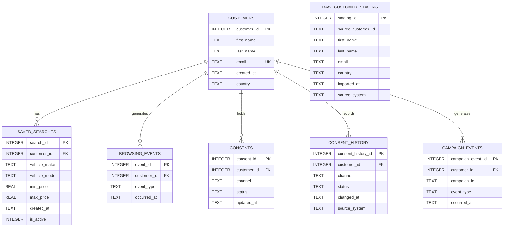

# AutoConnect — CRM Data Model & Entity Relationship Diagram

**Project:** AI-Powered CRM Lifecycle Automation  
**Version:** 1.0  
**Date:** 03 November 2026  
**Status:** Schema documented — validation pending  
**Database:** SQLite  
**Data:** Synthetic only

## 1. Purpose

This document describes the relational data model used by AutoConnect, an independent educational CRM automation portfolio project for a fictional European vehicle marketplace.

The model supports:

- Customer profile management
- Vehicle saved-search preferences
- Customer browsing activity
- Marketing consent and consent history
- Campaign engagement tracking
- Raw customer data staging and quality assessment
- SQL-based audience segmentation

The model separates unvalidated customer records from validated CRM records.

## 2. Entity Relationship Diagram (ERD)

**Diagram note:** `RAW_CUSTOMER_STAGING` is intentionally disconnected from the validated customer relationships. Its `source_customer_id` is a source-system identifier, not a foreign key to `CUSTOMERS`.

## 3. Table Definitions

| Table | Purpose | Primary key |
|---|---|---|
| `customers` | Validated customer profiles | `customer_id` |
| `saved_searches` | Customer vehicle preferences | `search_id` |
| `browsing_events` | Customer activity records | `event_id` |
| `consents` | Current marketing preferences | `consent_id` |
| `consent_history` | Historical consent changes | `consent_history_id` |
| `campaign_events` | Campaign interactions | `campaign_event_id` |
| `raw_customer_staging` | Unvalidated imported customer data | `staging_id` |

## 4. Relationships and Cardinality

| Parent | Child | Relationship |
|---|---|---|
| `customers` | `saved_searches` | One-to-many |
| `customers` | `browsing_events` | One-to-many |
| `customers` | `consents` | One-to-many, maximum one per channel |
| `customers` | `consent_history` | One-to-many |
| `customers` | `campaign_events` | One-to-many |

Each child record must reference an existing customer when SQLite foreign-key enforcement is enabled.

The `consents` table has a unique constraint on `(customer_id, channel)`, preventing multiple current-consent records for the same customer and communication channel.

The `raw_customer_staging` table has no foreign-key relationship to the validated customer tables.

## 5. Data Integrity Rules

### Customer profiles

- Each validated customer has a unique `customer_id`.
- Email is mandatory and unique in the `customers` table.
- Email-format validation is not yet enforced by the schema.
- Raw staging records may contain duplicate, missing or malformed email addresses.

### Saved searches

- Every saved search belongs to an existing customer.
- A customer may have multiple saved searches.
- `is_active` accepts only `0` or `1`.

### Browsing activity

- Every browsing event belongs to an existing customer.
- Customer inactivity is derived from the latest recorded browsing event.
- Customers without browsing history require separate eligibility logic based on saved-search age, as defined in the approved journey specification.

### Marketing consent

- `consents` stores the current preference per customer and channel.
- `consent_history` stores historical changes.
- Consent status is restricted to `opted_in` or `opted_out`.
- Automatic synchronisation between current consent and consent history is not yet implemented.
- Campaign eligibility must use the validated current preference and must not rely on an outdated opt-in.

### Campaign interactions

- Campaign events are linked to customers using `customer_id`.
- `campaign_id`, `event_type` and `occurred_at` support campaign engagement and suppression analysis.
- Event types are not yet restricted to a predefined list.

## 6. Raw Data Staging and Quality Controls

The staging layer is designed to simulate CRM data-quality problems.

Planned synthetic test scenarios include:

1. Duplicate email addresses
2. Missing email addresses
3. Invalid email formats
4. Inconsistent email capitalisation or whitespace
5. Conflicting customer information
6. Consent changes over time

Future SQL validation will identify invalid records, standardise relevant fields and apply deterministic deduplication rules.

The staging table does not automatically load records into `customers`. A validated transformation process must be implemented and tested separately.

## 7. Audience Segmentation Dependencies

The saved-search re-engagement journey depends on combining:

- Customer identity from `customers`
- Active vehicle preferences from `saved_searches`
- Latest browsing activity from `browsing_events`
- Current email permission from `consents`
- Recent campaign interactions from `campaign_events`

The approved journey specification defines inactivity thresholds, no-browsing-history eligibility, consent checks, deduplication and contact suppression.

The SQL implementation and test cases will be validated in later activities.

## 8. Technical Design Decisions

**SQLite:** Selected for a lightweight, reproducible local prototype.

**Primary and foreign keys:** Used to preserve customer relationships and referential integrity.

**Separate staging layer:** Allows realistic data-quality testing without weakening validated customer constraints.

**Consent history:** Preserves historical changes while the current-consent table supports operational queries.

**Timestamp storage:** Dates and times are stored as text. Consistent timestamp formatting is required for reliable comparisons.

**Indexes:** Customer and event-date indexes support segmentation and historical activity lookups.

**Foreign-key enforcement:** SQLite connections must enable `PRAGMA foreign_keys = ON`. The schema includes this instruction, but every application connection must enforce it appropriately.

## 9. Implementation and Validation Status

**Implemented in `sql/schema.sql`:**

- Seven table definitions
- Primary keys
- Foreign-key relationships for core CRM records
- Unique current-consent constraint
- Basic status checks
- Segmentation indexes
- Raw customer staging structure
- Consent-history structure

**Pending verification or implementation:**

- Execute the updated seven-table schema locally
- Confirm foreign-key enforcement
- Validate relationships and constraints using SQL tests
- Generate the expanded synthetic dataset
- Implement staging-data quality checks
- Implement consent-history consistency checks
- Validate campaign audience selection and suppression

## 10. Related Project Files

- [`sql/schema.sql`](../sql/schema.sql) — Implemented database schema
- [`sql/seed.sql`](../sql/seed.sql) — Initial synthetic records
- [`docs/journey-specification.md`](journey-specification.md) — Approved journey eligibility and governance requirements

---

**Portfolio disclaimer:** AutoConnect is an independent educational portfolio project based on a fictional vehicle marketplace. All business scenarios and customer records are synthetic. The prototype is not a production CRM system.
